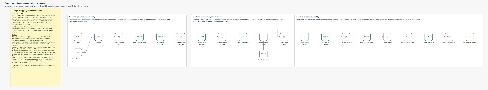

# Compact horizontal workflow

The 2026-11-07 update reduces the canvas from 33 to **26 items**: 28 execution/model nodes become **22**, and five notes become **four**. The entire main path runs from left to right on one row. The alternate daily trigger sits below the manual entry, and the OpenAI model sits below its chain node. The overview and three stage notes are aligned horizontally.

The documentation pass uses one yellow overview at the upper left, with 245 English words and `How it works` / `Setup` sections. Three white section notes contain 38, 41, and 39 words. Their text occupies a reserved area above each node group; note regions do not overlap. Individual node notes explain configuration, branch destinations, outputs, and failure behavior in English.

This diagram represents the exported node coordinates, not an n8n editor screenshot.

## Consolidated steps

| Removed canvas node | Responsibility now handled by |
| --- | --- |
| Select Baselines | Build Keyword Searches, after both history reads |
| Normalize Shopping Results | Measure Shelf and Compare |
| Prepare Analysis | Measure Shelf and Compare, only when analysis is enabled and useful |
| Expand Product Snapshots | Build Shopping Report |
| Expand Keyword Metrics | Check Product Saves |
| Check Metric Saves | Finalize Report |

The underlying calculation and report helpers remain independently testable. The builder calls compact composition helpers to combine adjacent preparation/checking steps. Thordata, Google Sheets, OpenAI, and Slack retain their native nodes and credential selectors.

## Item and failure behavior

`Build Shopping Report` emits product rows. Only its first row carries a complete `_context` envelope; the remaining rows contain only their product fields. The Sheets node uses explicit column mappings, so `_context` is never written to a cell. When no products are available, the node emits one context-only item, and `Have Product Snapshots?` bypasses the write.

`Check Product Saves` checks every expected row acknowledgment and emits keyword metric rows with one first-item context. `Finalize Report` checks metric acknowledgments before rendering final save status. The final outcome node still runs after the HTML report is available, preserving visible failure for all-request failure and incomplete persistence.

The full context is attached once per batch, not repeated on every product. Keyword associations still use request IDs and n8n item links. AI runs at most once per run, and Slack remains gated by events or operational issues. Both history reads still fail before any paid search if they cannot be completed.

## Compatibility and verification

The update does not change Settings defaults, metric definitions, snapshot/row IDs, worksheet headers, price support, or notification thresholds. Existing historical snapshots remain compatible. No live credentials or destinations are embedded in the export.

New tests check node count, a single horizontal main row, forward connections, removed-node references, merged computations, context placement, zero-product bypass, and save failures. The real n8n fixture suite also checks unchanged runs, failure of either history read, context exclusion from Sheets, and all existing success/failure cases. See [Validation](VALIDATION.md) for completed results.

Reimport the complete updated JSON into n8n and transfer your existing Settings and credential selections. An old imported copy does not automatically receive the new graph or positions. Keep the workflow inactive until a manual run with your account configuration succeeds.
